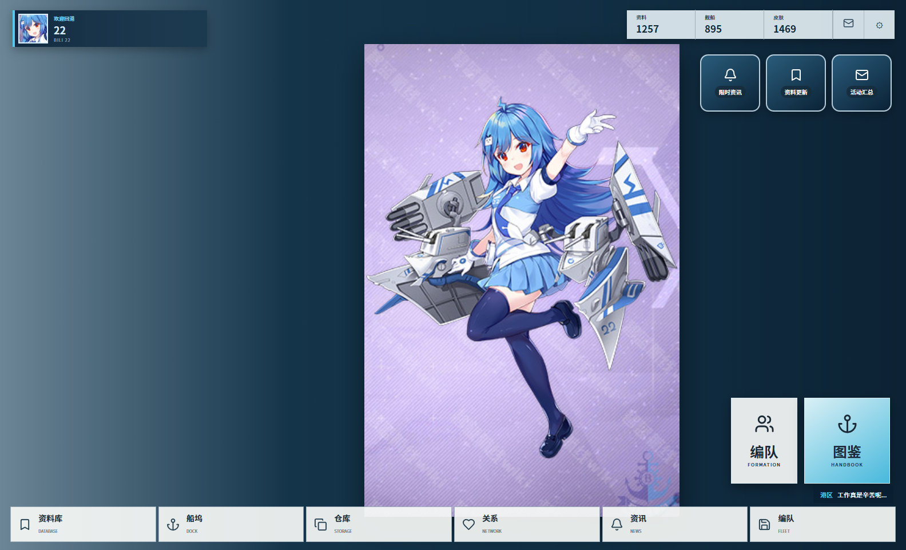
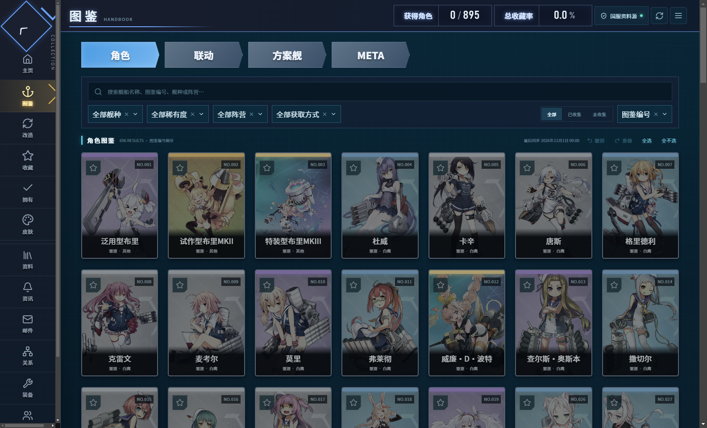
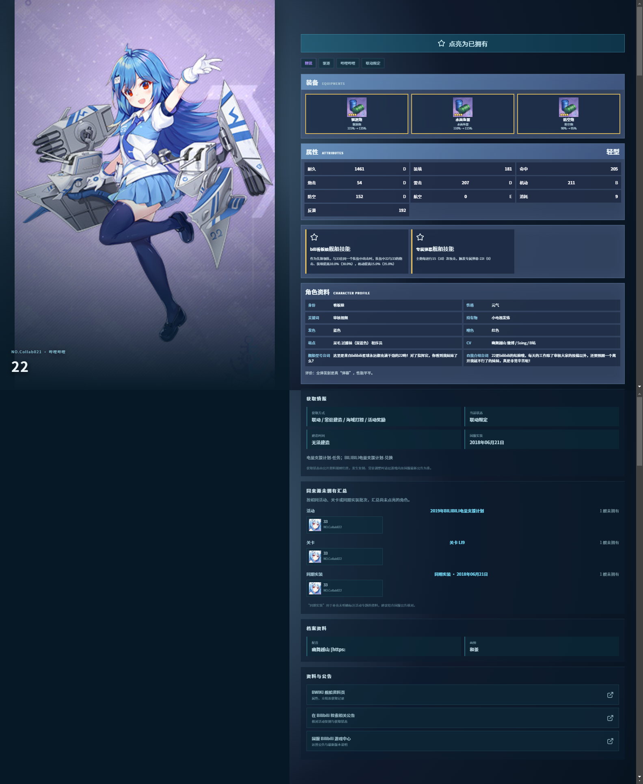
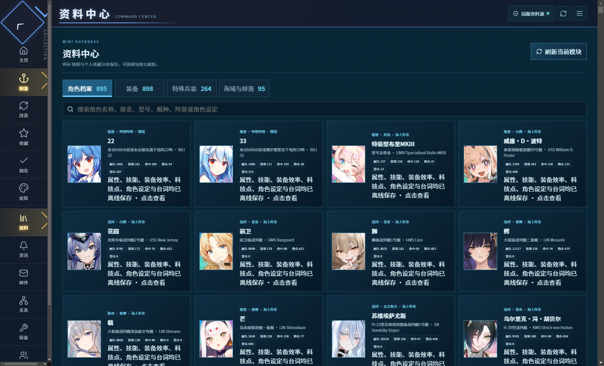
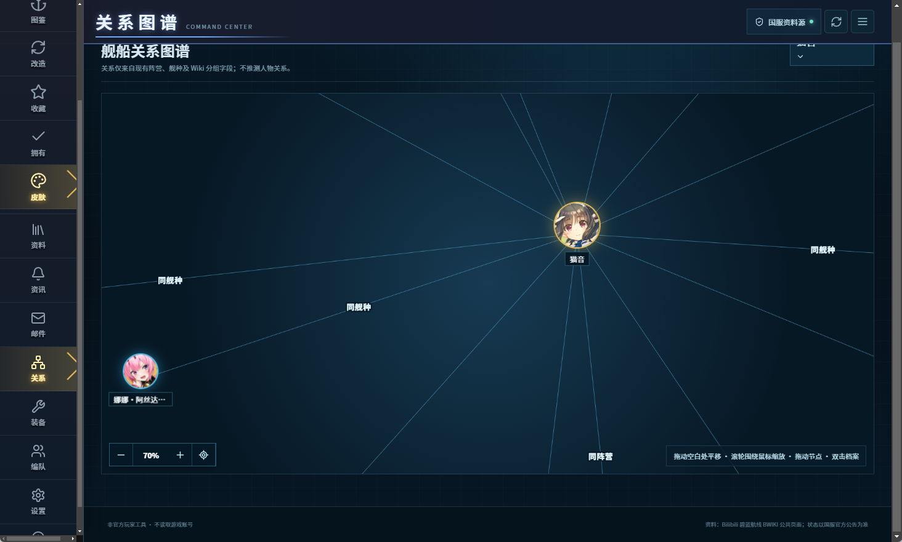
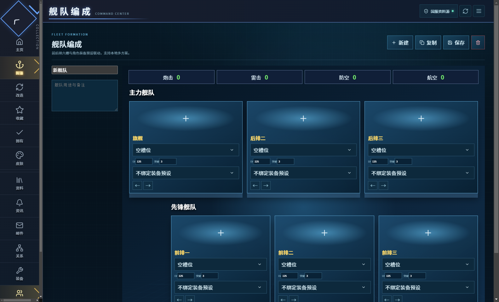

# 碧蓝航线国服舰船图鉴

<p align="center">
  <a href="https://github.com/alvesquele967-ops/azur-lane-archive-cn/releases/latest"></a>
  <a href="https://github.com/alvesquele967-ops/azur-lane-archive-cn/releases/latest"></a>
  <a href="LICENSE"></a>
</p>

一款面向《碧蓝航线》国服玩家的 Windows 桌面舰船资料库与收藏管理工具。应用基于 Electron、Vue 3 与 TypeScript 开发，不登录或读取游戏账号；收藏、装备预设、舰队方案与设置均保存在本地。



港区风格主页可从本地舰船和皮肤资料中选择展示角色，并保存立绘缩放、位置与显示区域。底部入口可直达资料库、关系图谱、资讯与舰队编成。

## 界面预览

### 舰船图鉴



覆盖普通、改造、方案舰、META、联动、游戏收藏奖励、已拥有舰船与皮肤画廊。支持名称、历史原名、舰种、稀有度、阵营和获取方式组合搜索，并提供可撤销的批量全选与全不选。

### 完整角色档案



角色详情长图由应用真实界面分段滚动并拼接生成。档案包含立绘、装备槽与效率、满级属性、技能、角色设定、获取状态、同活动或同关卡未拥有舰船汇总、配音画师和资料链接。

<table>
  <tr>
    <td width="50%"></td>
    <td width="50%"></td>
  </tr>
  <tr>
    <td align="center"><b>本地 Wiki 资料中心</b><br>舰船档案、装备、特殊兵装及海域掉落按模块保存与更新。</td>
    <td align="center"><b>动态关系图谱</b><br>自由平移、节点拖动、鼠标位置缩放与档案跳转。</td>
  </tr>
</table>

### 舰队编成



支持前后排六槽编队、多套舰队方案、位置调整与角色装备预设联动；公开资料无法提供的等级、突破和强化信息可由用户自行填写。

## 功能概览

- 内置 1004 条舰船与改造档案，以及 898 件装备、264 件特殊兵装和 95 条海域掉落索引。
- 从碧蓝海事局 BWIKI 按模块同步公开资料，支持增量更新、失败重试、图片缓存和手动刷新。
- Wiki 资料与个人收藏严格分离，同步不会覆盖收藏、星级、装备预设或舰队方案。
- 单船点亮、批量操作、持久化撤销与重做，以及同活动、关卡或同期实装的未拥有舰船汇总。
- 高清立绘查看、独立皮肤画廊、国服名称与历史原名切换，两种名称均可搜索。
- 每艘舰船可保存多套装备方案，并与六槽舰队编成联动。
- 资料更新会生成本地邮件摘要；支持定时刷新、系统托盘后台运行和 Windows 通知。
- 收藏、邮件、预设、舰队与设置支持导入导出及 SQLite 完整备份。

## 下载

请从 [Releases](https://github.com/alvesquele967-ops/azur-lane-archive-cn/releases/latest) 下载：

- `azur-lane-archive-cn-1.3.4-x64-setup.exe`：Windows x64 安装版。
- `azur-lane-archive-cn-1.3.4-x64-portable.exe`：Windows x64 绿色便携版。

项目暂未配置商业代码签名，Windows 首次运行时可能显示安全提醒。

## 数据来源与边界

- 舰船、角色、装备、兵装、地图与皮肤资料主要来自 Bilibili 托管的[碧蓝航线 BWIKI](https://wiki.biligame.com/blhx/)。BWIKI 内容由社区维护，并非游戏官方数据库。
- 活动开放、复刻和常驻调整等即时状态应以游戏内公告及[国服 Bilibili 游戏中心](https://www.biligame.com/detail/?id=97)为准。
- 应用不使用游戏账号、不读取游戏客户端数据，也不接入来源不明的私人接口。

## 本地开发

需要 Node.js 20 或更高版本。

```powershell
npm install
npm run typecheck
npm test
npm run build:web
npm run build:offline
```

刷新内置公开资料快照：

```powershell
npm run sync:data
node scripts/sync-wiki-module.mjs all data/wiki.json
```

如需指定 Electron 国内镜像：

```powershell
$env:ELECTRON_MIRROR = "https://npmmirror.com/mirrors/electron/"
npm run build:offline
```

## 本地数据位置

- 安装版：Electron 用户数据目录。
- 绿色版：优先在 EXE 同目录创建 `碧蓝航线舰船图鉴数据`；目录不可写时回退到系统用户数据目录。
